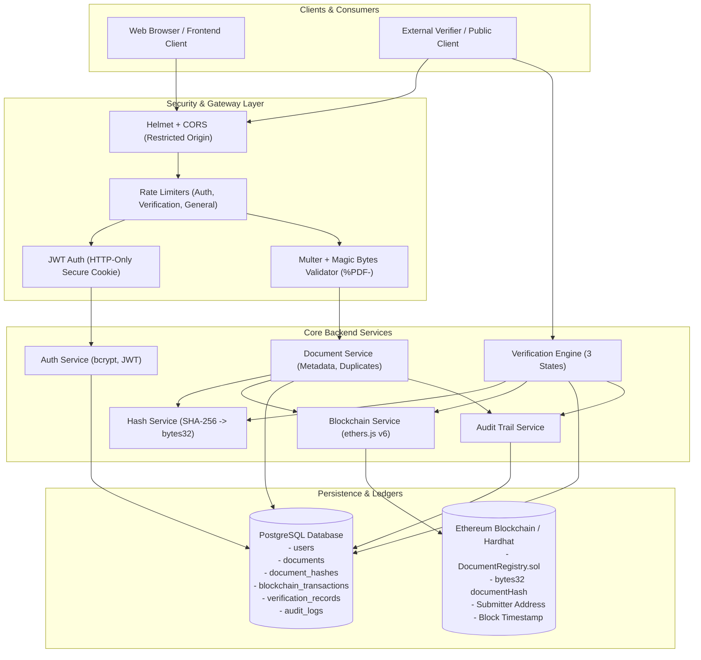
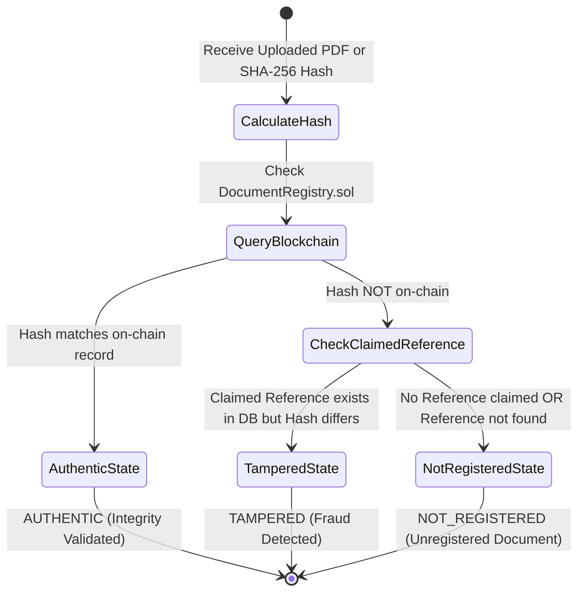
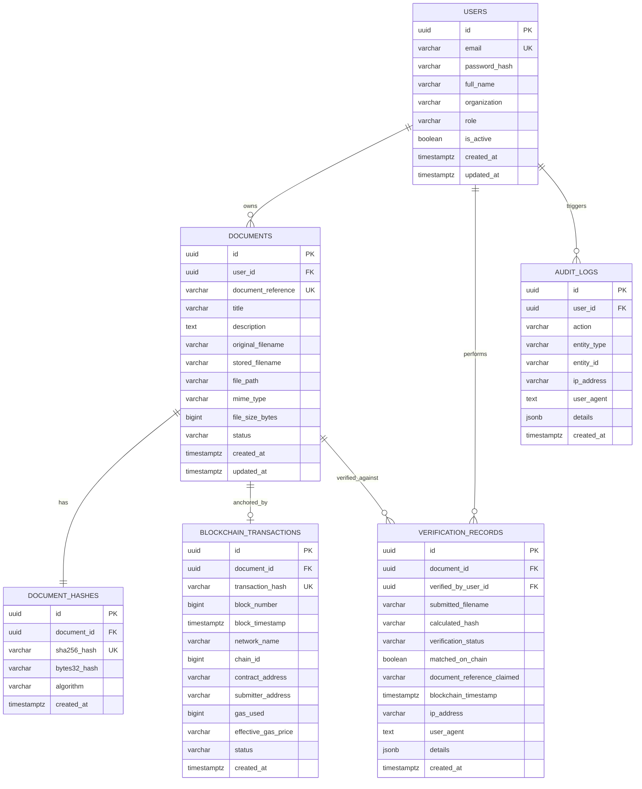

# System Architecture: Blockchain-Based Document Integrity Verification System (ChainProof)

## 1. Executive Summary & Purpose

The **ChainProof Document Integrity Verification System** is an enterprise-grade backend architecture developed for university seminar demonstration, cryptographic auditing, and verifiable credential management. The system guarantees that once a digital document (specifically portable document format, PDF) is registered, any subsequent modification, byte truncation, unauthorized metadata modification, or fraud is immediately detectable.

The system harmonizes three distinct architectural layers:
1. **Application & Cryptographic Layer**: Node.js/Express.js backend utilizing deterministic SHA-256 byte extraction, Zod schema validation, and secure HTTP-only cookie authentication.
2. **Relational Ledger & Audit Layer**: PostgreSQL database enforcing foreign key relationships, immutable audit logs, document version references, and user access policies.
3. **Decentralized Ledger Layer**: Ethereum-compatible Solidity smart contract (`DocumentRegistry.sol`) running on a local Hardhat node or public testnet (e.g., Sepolia), storing 32-byte cryptographic digests with submitter identities and blockchain timestamps.

---

## 2. High-Level Architectural Diagram

---

## 3. Cryptographic Pipeline & Integrity Invariants

### 3.1. Hashing Pipeline
- **Raw Byte Processing**: Documents are read directly into binary streams or memory buffers. The system niemals trusts user-supplied file names or file extensions.
- **SHA-256 Digest**: Computed via Node.js native `crypto.createHash('sha256')`, producing a deterministic 64-character hexadecimal string:
  $$\text{Hash} = \text{SHA-256}(\text{Document Bytes})$$
- **Solidity Conversion**: The 64-character hexadecimal digest is converted into an Ethereum-native `bytes32` type (`0x` prefixed with 64 hex characters):
  $$\text{bytes32} = \text{0x} + \text{Hash}$$

### 3.2. Verification Engine Tri-State Invariants

The verification engine enforces three mutually exclusive, mathematically rigorous outcomes:

1. **`AUTHENTIC`**:
   - **Condition**: The computed SHA-256 digest exists in the `DocumentRegistry` contract mapping.
   - **Meaning**: The document is byte-for-byte identical to the version registered on-chain.
   - **Payload**: Includes on-chain submitter address, mined block number, registration timestamp, and document reference.

2. **`TAMPERED`**:
   - **Condition**: A claimed document identity or tracking reference (e.g., `DOC-20261101-ABCD`) is asserted by the user or embedded barcode, and that reference exists in the registered database ledger, **BUT** the computed byte-level SHA-256 hash does not match the baseline hash.
   - **Meaning**: The document has been intentionally altered, modified, forged, or corrupted.
   - **Payload**: Includes registered title, original expected SHA-256 hash, computed actual hash, and registration date.

3. **`NOT_REGISTERED`**:
   - **Condition**: The computed SHA-256 hash does not exist on the blockchain, and no valid established document reference was claimed.
   - **Invariant**: Strict avoidance of false tampering reports. An unknown document is never classified as `TAMPERED` merely because it is unregistered.

---

## 4. PostgreSQL Relational Database Schema

---

## 5. Solidity Smart Contract Architecture

The smart contract `DocumentRegistry.sol` is designed with minimal gas overhead:
- **Storage**: `mapping(bytes32 => DocumentRecord) private records;` ensures $O(1)$ lookup time and prevents hash collisions.
- **Uniqueness Check**: `require(!records[documentHash].exists, "DocumentRegistry: document hash already registered");` prevents front-running and double-registration.
- **Event Logging**: `emit DocumentRegistered(bytes32 indexed documentHash, address indexed submitter, uint256 registeredAt, string docReference, uint256 blockNumber);` enables indexing by subgraphs and off-chain listeners.
- **View Method**: `verifyDocument(bytes32 documentHash)` returns the boolean existence flag, submitter address, timestamp, docReference, and block number with zero gas cost for read operations.

---

## 6. Cybersecurity & Defense-in-Depth

| Security Vector | Implementation Detail |
|---|---|
| **Session Security** | HTTP-Only, `SameSite=Lax`, and SSL/TLS secure cookie delivery prevents client-side XSS token theft. |
| **Password Hashing** | Adaptive `bcrypt` salt rounds (cost factor 10) mitigate rainbow table and offline GPU attacks. |
| **File Upload Hardening** | Extension check (`.pdf`), MIME verification (`application/pdf`), and 5-byte file header validation (`%PDF-`). Stored outside web server document root in `./storage/documents` with randomized UUID file names to eliminate directory traversal and remote code execution (RCE). |
| **SQL Injection Prevention** | 100% parameterized queries via `pg` connection pool with zero dynamic string concatenations. |
| **DDoS & Brute Force Defense** | Multi-tier `express-rate-limit`: General API (100 req/15min), Auth endpoints (20 req/15min), Verification (60 req/15min). |
| **HTTP Headers** | `helmet` enforces Content Security Policy (CSP), HTTP Strict Transport Security (HSTS), X-Content-Type-Options: `nosniff`, and clickjacking defense (`X-Frame-Options: DENY`). |
| **Role-Based Access Control** | Strictly partitioned `USER` and `ADMIN` roles enforced by dedicated Express middleware gates. |

